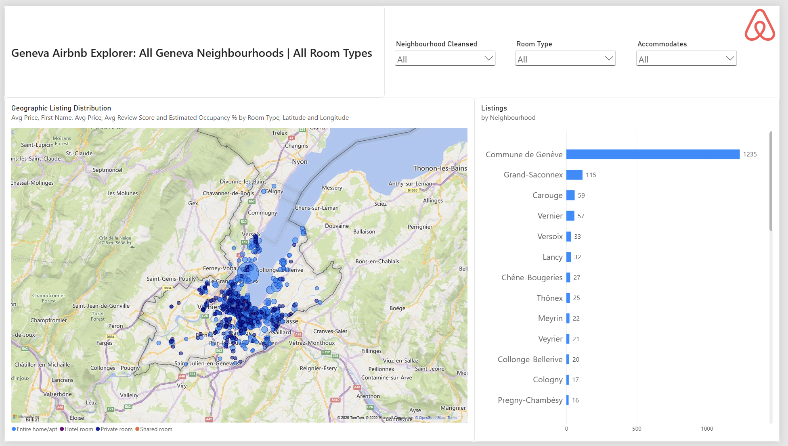
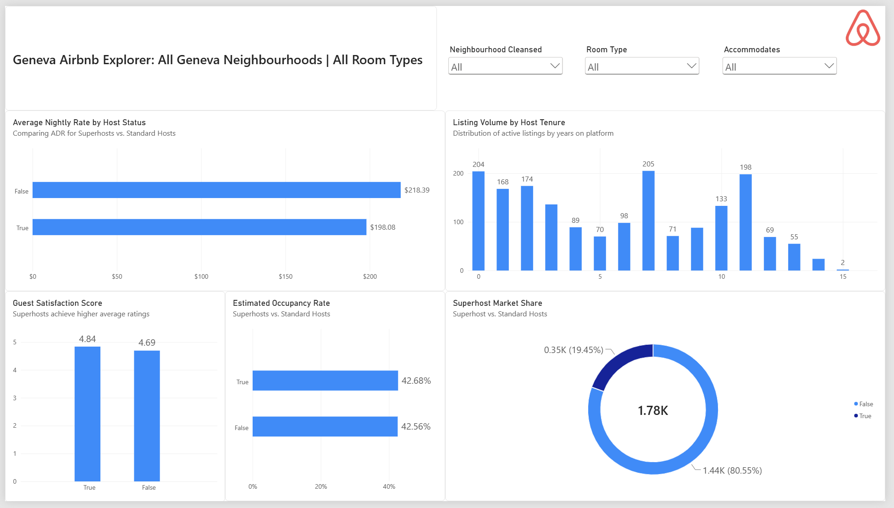
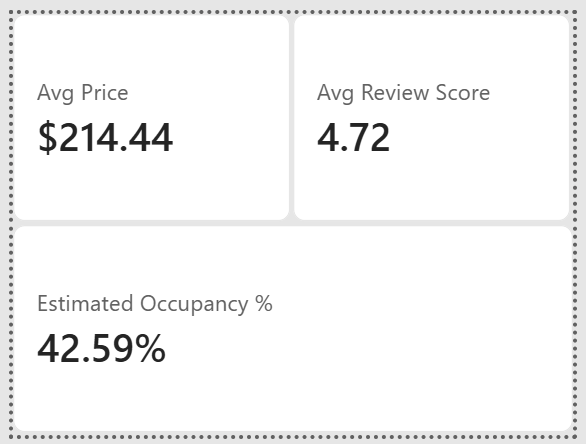
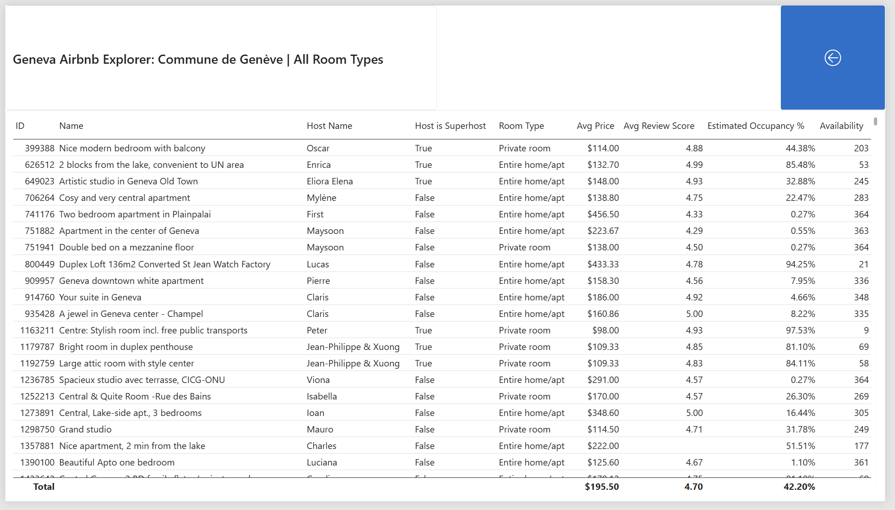

# Geneva Airbnb Market & Pricing Explorer

An executive-level Power BI analytics dashboard designed to analyze market dynamics, pricing distributions, geographic concentration, host performance, and simulated monthly revenue for Airbnb listings in Geneva, Switzerland.

---

## Executive Summary & Key Market Insights

* **Market Scale & Core KPIs:** Geneva's active Airbnb market comprises **1,784 listings** with an overall average nightly rate (ADR) of **$214.44**, a median price of **$153.93**, an average guest review score of **4.72**, and an estimated occupancy rate of **42.59%**.
* **Supply Composition:** Entire homes/apartments dominate the market, accounting for **69% (1.23K listings)** of total inventory, followed by private rooms at **31% (0.55K listings)**.
* **Geographic Concentration:** Market volume is heavily concentrated in the urban center, **Commune de Genève** represents **1,235 listings (69.2% of total volume)**, followed by municipal hubs such as **Grand-Saconnex (115 listings)**, **Carouge (59 listings)**, and **Vernier (57 listings)**.
* **Host Performance Dynamics:** Superhosts represent **19.45% (350 listings)** of total active supply. While Superhosts command higher guest satisfaction ratings (**4.84** vs. **4.69** for standard hosts) and slightly higher occupancy (**42.68%** vs. **42.56%**), standard hosts average higher nightly rates (**$218.39** vs. **$198.08**).
* **Revenue Potential:** Under baseline scenario settings (2-day average stay length, 65% review rate), total simulated market revenue in Geneva reaches **$832.94K per month**, with Entire Homes generating **79.55% ($662.58K)** of total market earnings.

---

## Dashboard Architecture & Visualizations

### 1. Market Overview

Displays high-level KPI summary cards, room type inventory distribution, nightly price binning ($100 steps up to $600 to manage extreme outlier skew), and a dynamic metric switcher comparing neighbourhoods.


### 2. Map View

Features an interactive geographic bubble map using exact coordinates aggregated by room type alongside a horizontal bar chart of listing density across all Geneva neighbourhoods.



### 3. Neighbourhood Comparison

Combines an interactive matrix table with conditional data bars for pricing, ratings, and occupancy alongside a scatter plot evaluating **Median Price vs. Guest Review Score**.


### 4. Host Analytics

Evaluates host dynamics by comparing average pricing, review scores, and occupancy between Superhosts and standard hosts, while charting listing volume across host tenure.



### 5. What-If Revenue Simulator

Allows interactive simulation of total monthly market revenue by adjusting dynamic parameter sliders for **Assumed Average Stay Length** (1–14 days) and **Review Rate %** (10%–100%).


### 6. Report Tooltips & Drill-Through Navigation

Hovering over map nodes or scatter plot points displays custom report tooltips. Users can right-click any neighbourhood to drill through to a complete listing-level detail view with dynamic header contextualization.

| Custom Report Tooltip | Listing Detail Drill-Through View |
| :---: | :---: |
|  | 

The report is built on a clean **Star Schema** data structure in Power BI:


* **Fact Table:** `FactListings` (contains listing details, pricing, location coordinates, review volume, and annual availability).
* **Dimension Tables:** `DimHost`, `DimRoomType`, `DimNeighbourhood`.
* **What-If Parameter Tables:** `Assumed Avg Stay Length`, `Review Rate %`, `Market Metric Parameter`.
* **Central Measures Table:** `_Measures` (houses all core DAX expressions, dynamic headers, and parameter logic).

---

## Key DAX Formulas

### Dynamic What-If Monthly Revenue Calculation

```dax
Estimated Monthly Revenue =
VAR SelectedStayLength = [Assumed Avg Stay Length Value]
VAR SelectedReviewRate = [Review Rate % Value]

// Proxy calculation estimating stays from annual review velocity:
VAR TotalReviewsLTM = SUM(FactListings[number_of_reviews_ltm])
VAR EstStays = DIVIDE(TotalReviewsLTM, SelectedReviewRate, 0)
VAR EstNightsBooked = EstStays * SelectedStayLength
VAR EstAnnualRevenue = EstNightsBooked * [Avg Price]

RETURN
DIVIDE(EstAnnualRevenue, 12, 0)
```

### Parameter Harvester Measures

```dax
Assumed Avg Stay Length Value =
SELECTEDVALUE('Assumed Avg Stay Length'[Assumed Avg Stay Length], 3)

Review Rate % Value =
SELECTEDVALUE('Review Rate %'[Review Rate %], 0.50)
```

---

## Repository File Structure

```plaintext
.
├── data/
│   └── listings.csv
├── docs/
│   └── Airbnb Market & Pricing Explorer.pdf
├── images/
│   ├── airbnb.jpg
│   ├── host.png
│   ├── listings.png
│   ├── map.png
│   ├── model.png
│   ├── neighbourhood.png
│   ├── overview.png
│   ├── revenue.png
│   └── tooltip.png
└── pbix/
|   └── Airbnb Market & Pricing Explorer.pbix
├── README.md
```

---

## Getting Started

1. Clone or download this repository.
2. Open `pbix/Airbnb Market & Pricing Explorer.pbix` using **Power BI Desktop**.
3. For offline document presentation or static exports, refer to `docs/Airbnb Market & Pricing Explorer.pdf`.                     