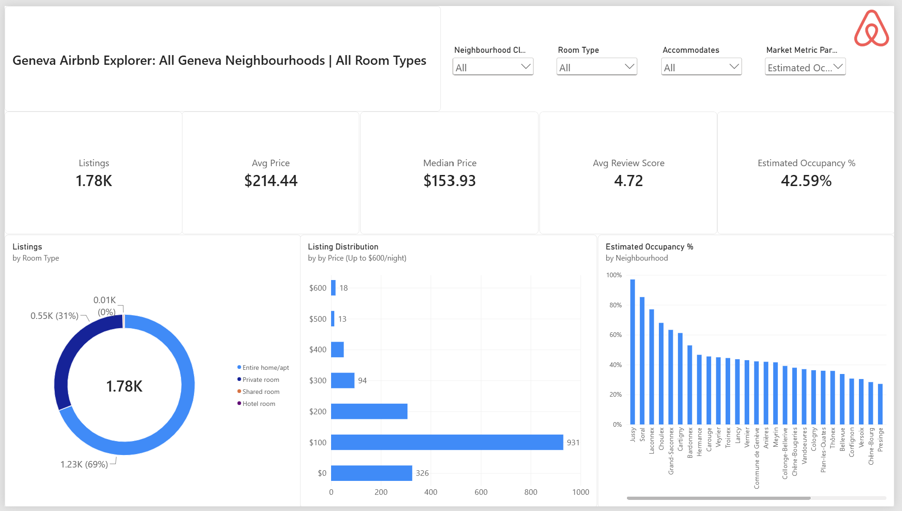
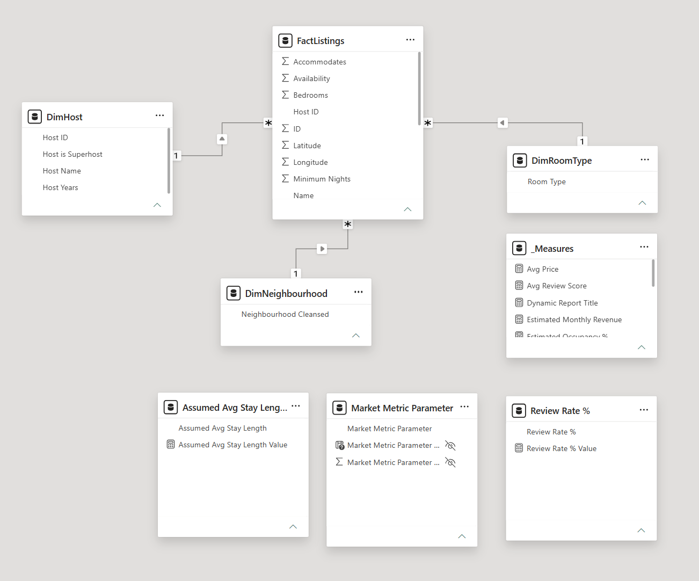
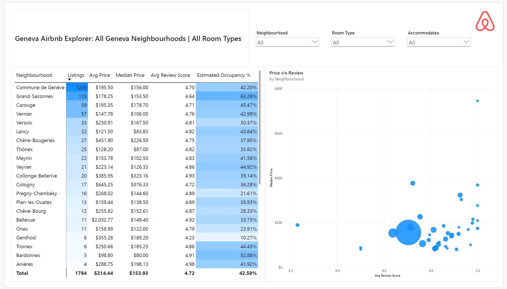
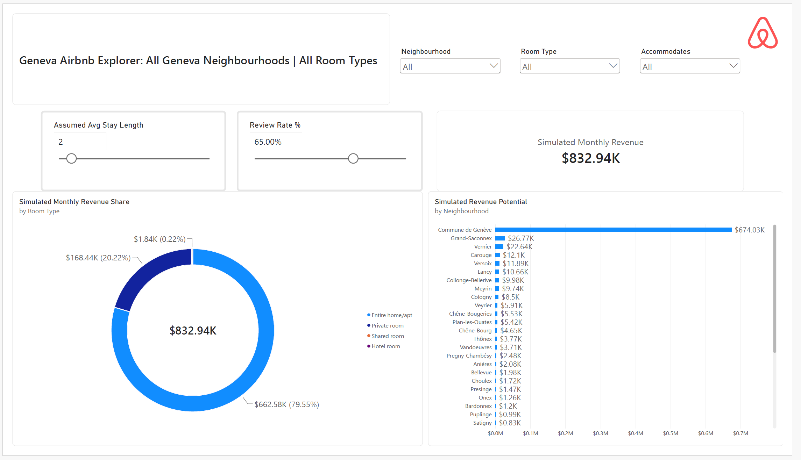

# Airbnb Market & Pricing Explorer: Geneva

A Power BI report that explores Geneva's short-term rental market: supply, listed prices, estimated occupancy, host types, and a simple revenue simulator. It is built to help a prospective host decide where to list and how to price.

> **Headline finding:** Geneva's Airbnb supply is concentrated in the city centre. **Commune de Genève holds 1,235 of 1,784 listings (about 69%)**. Premium-priced neighbourhoods such as Cologny and Chêne-Bougeries do not show higher estimated occupancy than the market overall (42.59%).



---

## Business Problem

A new host in Geneva needs to know where demand is concentrated, what typical listings charge, and whether premium locations or Superhost status pay off. This report answers those questions using public listing data.

## Dataset

- **Source:** Inside Airbnb, Geneva: http://insideairbnb.com/get-the-data/ (check their page for licence and attribution terms)
- **Size:** 1,784 listings
- **Currency:** USD $. Prices below use `\$` as displayed in the report.
- **One snapshot in time:** nothing here shows trends.

## Data Model

Star schema around a `Listings` fact table with dimensions for neighbourhood, room type and host, plus a date table where needed. Measures are held in a dedicated `_Measures` table.



## Data Preparation (Power Query)

- Cleaned the `price` field (text with a currency symbol and thousands separators) and converted it to a number.
- Handled missing values in reviews and bedrooms with documented rules.
- Created helper columns: price band, host type (Superhost or Standard host) and host tenure.
- The price histogram is capped at 600 per night to keep the chart readable. sice very few listings exist above $600, which relate to rest of the data, they are discarded as outliers.

## Key Metrics

| Metric | Value |
|---|---|
| Listings | 1,784 |
| Average listed price | \$214.44 |
| Median listed price | \$153.93 |
| Average review score | 4.72 |
| Estimated occupancy | 42.59% |

The average is well above the median because a few very expensive listings pull it up (for example, Bellevue averages \$2,032.77 but has a median of \$149.40). **Medians are the better guide to a typical price.**

## Report Pages

| Page | What it shows |
|---|---|
| Market Overview | KPIs, listings by room type, price distribution, estimated occupancy by neighbourhood |
| Map | Geographic distribution of listings, coloured by room type |
| Neighbourhood Comparison | Table of listings, price, reviews and occupancy; price vs review scatter |
| Hosts | Superhost vs standard host comparison, host tenure |
| Revenue Simulator | What-if sliders for average stay length and review rate |
| Insights and Recommendations | Findings and suggestions for new hosts |

## Key Findings

1. **Supply is concentrated in the city centre:** Commune de Genève has 1,235 listings (about 69%). The next largest neighbourhood, Grand-Saconnex, has 115.
2. **Entire homes dominate:** 69% of listings (1.23K) are entire homes or apartments and 31% (0.55K) are private rooms. Shared and hotel rooms are almost absent.
3. **Occupancy varies widely by neighbourhood.** Among neighbourhoods large enough to compare , estimated occupancy ranges from about 22% (Pregny-Chambésy) to 63% (Grand-Saconnex), against 42.59% overall. Smaller neighbourhoods are excluded because a handful of listings gives unstable estimates (minimum listing count used is 10).
4. **Premium prices do not guarantee higher occupancy.** Cologny (median 376.33, 17 listings), Collonge-Bellerive (median 323.16, 20 listings) and Chêne-Bougeries (median 226.50, 27 listings) show estimated occupancy of 36.28%, 39.14% and 37.95%, all below the market average. These are small samples, so treat the pattern as indicative.
5. **Review scores barely separate listings.** The market average is 4.72, and most large neighbourhoods fall between 4.6 and 4.9, so ratings alone say little about performance.
6. **Superhosts:** they are 19.45% of listings (0.35K). Their median listed price ($154.67) is below that of standard hosts ($153.67), . Their average rating is higher (4.84 vs 4.69), which is partly by definition because Superhost status requires high ratings. Estimated occupancy is essentially the same (42.68% vs 42.56%).

## Revenue Simulator (illustrative only)

Two sliders (assumed average stay length and review rate) drive an estimate of monthly revenue. The approach is approximate: estimated stays come from reviews in the last 12 months divided by the review rate, then multiplied by the assumed stay length and the listed price. 

At the default settings of 2 nights and a 65% review rate, the whole market comes to about \$832.94K per month, of which entire homes account for \$662.58K (79.55%) and Commune de Genève for \$674.03K. **These are modelled estimates, not actual earnings.** Changing the assumptions changes the totals, and the shares are driven mostly by listing counts and prices.

## Suggestions for a New Host

These are ideas drawn from the data, not guarantees.

1. **Pick the neighbourhood with evidence in mind.** Compare occupancy, competition (listing count) and typical median price, and do not assume a premium area will fill more often.
2. **Price near the median for your area and room type** at launch, then adjust based on bookings and reviews.
3. **Entire homes dominate supply and estimated revenue**, but check occupancy by room type before choosing. Supply share alone does not show what guests prefer.
4. **Build good reviews early.** Ratings are high across the market, so a weak rating stands out.
5. **Aim for Superhost status as a trust signal**, not as a way to charge more. The data shows no price premium for Superhosts.

## Limitations

- **Occupancy is an estimate.** It is derived from calendar availability, but unavailable days include dates blocked by hosts, so true occupancy is unknown.
- **Revenue is simulated** from review counts and assumptions, not from real bookings.
- **Outliers and small neighbourhoods:** averages are sensitive to extreme prices, and neighbourhoods with few listings give unstable results.
- **Single snapshot** of one city.
- **Associations only:** the analysis does not control for room type, size or listing quality.

## How to Open

1. Download the Geneva `listings` file from Inside Airbnb and place it in `/data`.
2. Open `Airbnb Market & Pricing Explorer.pbix` in Power BI Desktop (Windows; map visuals must be enabled under Options > Security).
3. Update the source path in Power Query if prompted, then refresh.

## Repository Structure

```
.
|-- README.md
|-- Airbnb Market & Pricing Explorer.pbix
|-- images/
|   |-- airbnb.png
|   |-- host.png
|   |-- insights.png
|   |-- listings.png
|   |-- map.png
|   |-- model.png
|   |-- neighbourhood.png
|   |-- overview.png
|   |-- recommendations.png
|   |-- revenue.png
|   |-- tooltip.png
|-- docs/
|   |-- Airbnb Market & Pricing Explorer.pdf
```

## Skills Demonstrated

Power Query (M) cleaning of messy text fields, star-schema modelling, DAX with what-if parameters, geographic visuals, outlier-aware use of medians, and writing honest assumptions and limitations.

## Change Log

- **v2:** renamed misleading labels ("ADR" to listed price, True/False to Superhost/Standard), limited the occupancy chart to larger neighbourhoods, added insights and recommendations pages, and enabled the map visual.

## Images






## Author

Dhawan Singh Saini | [LinkedIn](https://linkedin.com/in/dhawan-singh-saini)
